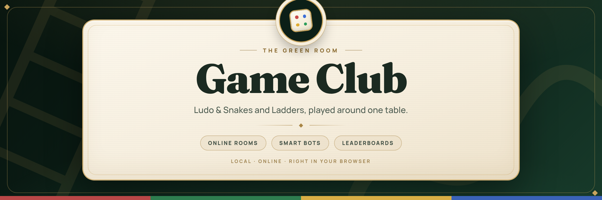
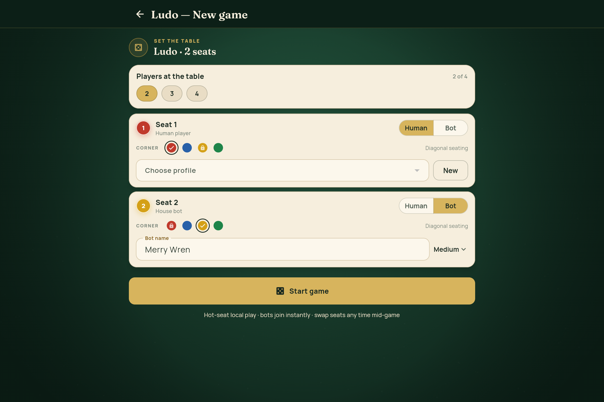
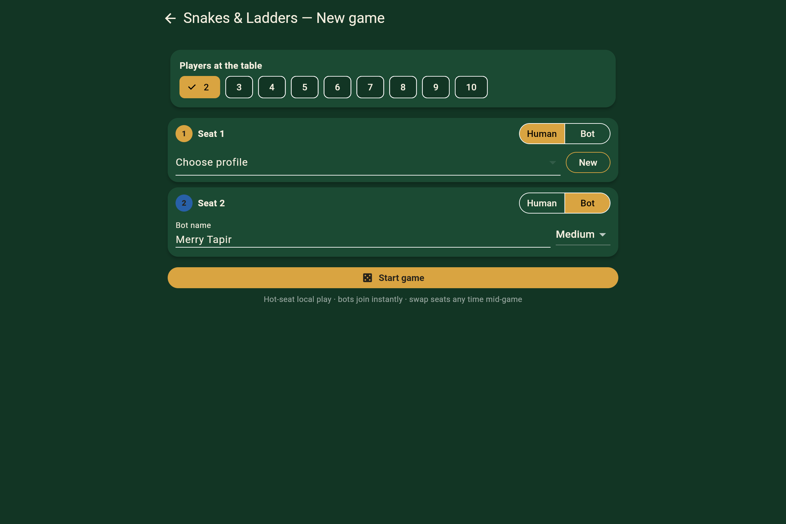
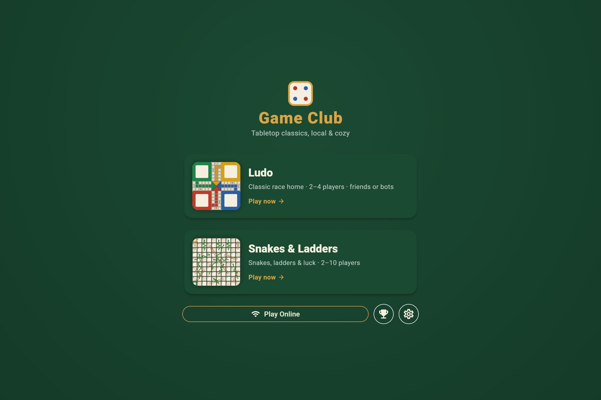
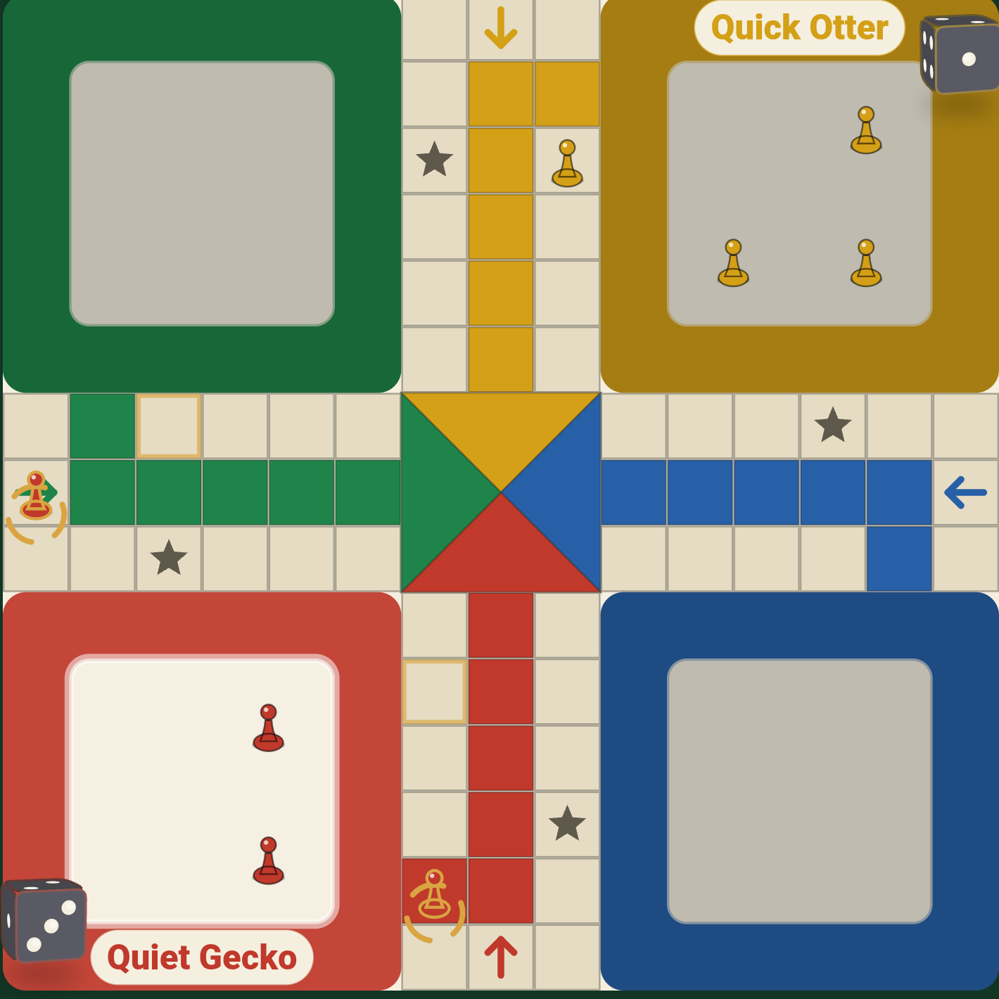
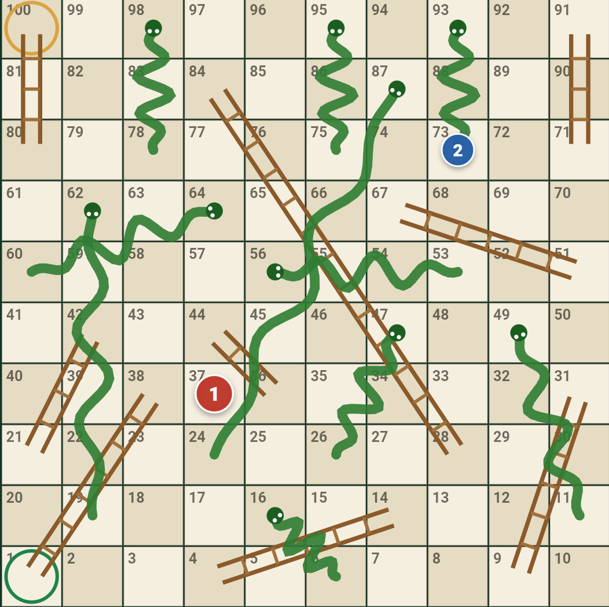
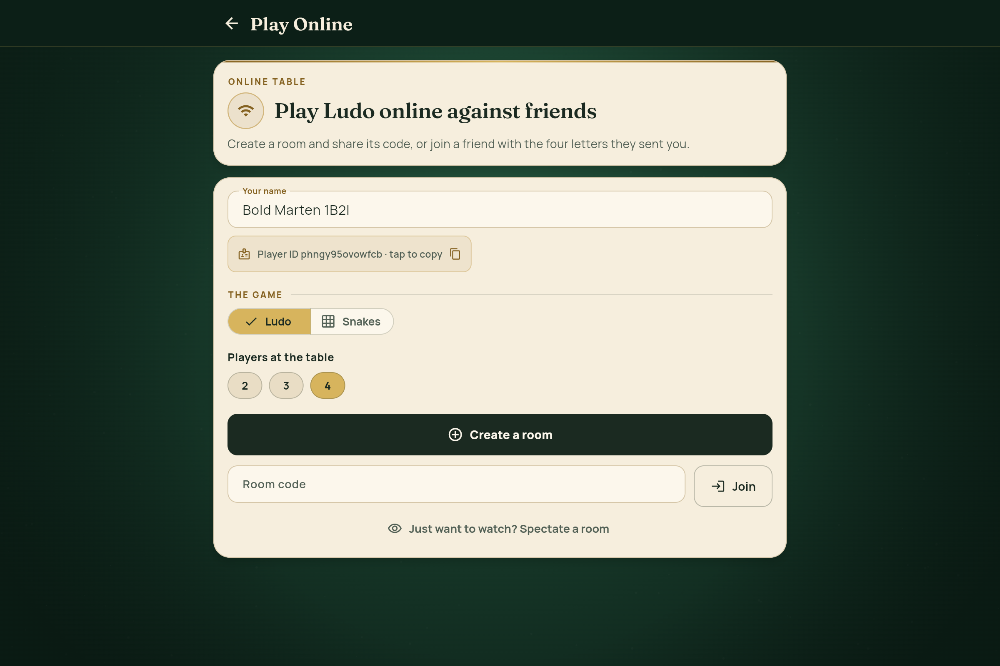
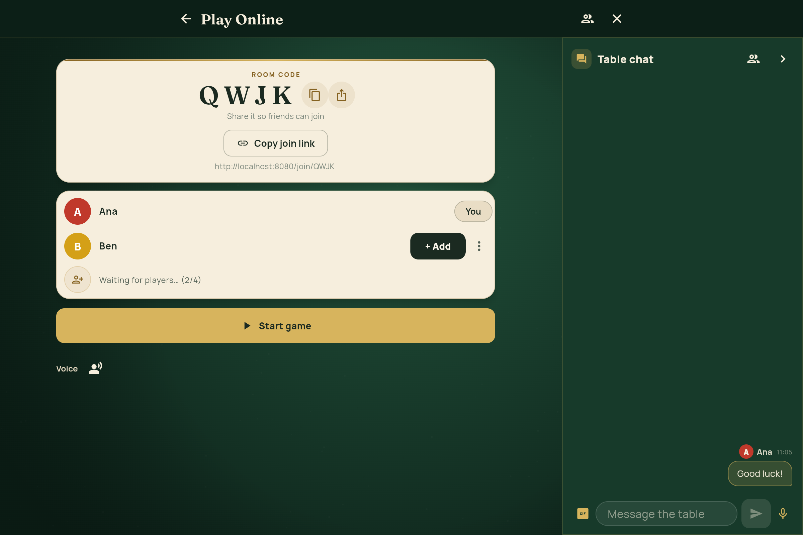
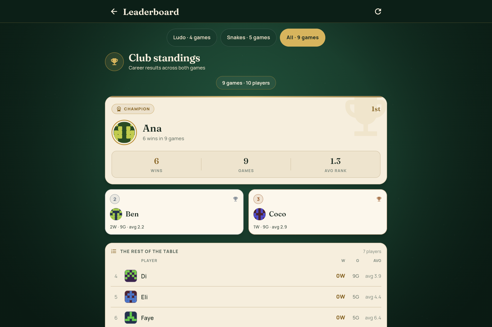
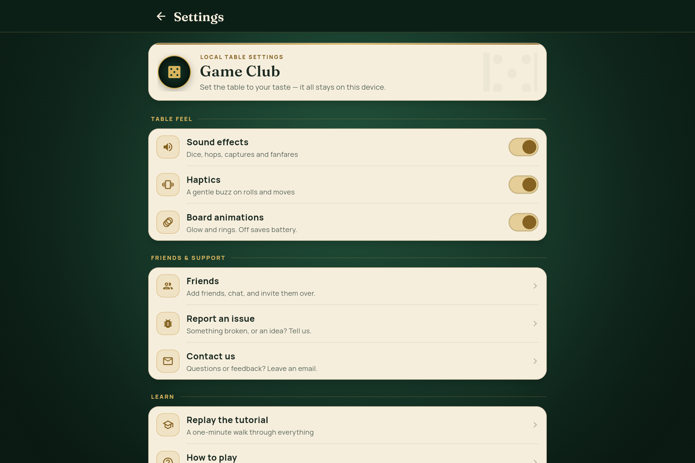

<h1 align="center">🎲 Game Club</h1>

<p align="center">
  <b>Ludo</b> &amp; <b>Snakes &amp; Ladders</b> — play hot-seat, against smart bots, or online
  with rooms, chat, reconnect &amp; leaderboards.<br/>
  One Flutter codebase for web, desktop &amp; mobile — plus a Chrome &amp; Firefox extension.
</p>

<p align="center">
  
  
  
  
  
</p>

<p align="center">
  
</p>

<p align="center">
  <a href="#-games--rules">🎲 Games &amp; rules</a> ·
  <a href="#-screenshots">📸 Screenshots</a> ·
  <a href="#-architecture">🏗 Architecture</a> ·
  <a href="#-getting-started">🚀 Getting started</a> ·
  <a href="#-branches-prs--ci">🌲 Branches &amp; CI</a> ·
  <a href="#-tooling">🛠 Tooling</a> ·
  <a href="#-online-play--deploy">🌐 Online &amp; deploy</a> ·
  <a href="#-browser-extension">🧩 Extension</a> ·
  <a href="#-contributing">🤝 Contributing</a>
</p>

---

## 🎲 Games & rules

| | 🎲 Ludo | 🐍 Snakes & Ladders |
|---|---|---|
| Players | 2–4 (red / green / yellow / blue), 4 tokens each | 2–10, coexisting pawns |
| Board | 52-cell track, safe cells &amp; home columns | 100 squares, 9 ladders, 10 snakes |
| Start | roll a **6** to leave the base | roll a **1** to enter |
| Win | exact entry into the home triangle | exact landing on 100 (overshoot bounces back) |
| Bots | easy / medium / hard | auto-play |
| Online | ✅ rooms, chat, voice, reconnect, spectate, autoplay | ✅ rooms, chat, voice, reconnect, spectate, autoplay |

### 🎲 Ludo (classic)

- Roll a **6** to leave the base; a 6 grants an **extra roll** — so does a capture or bringing a token home.
- **Three consecutive 6s** forfeit the turn.
- **Safe cells**: every start cell plus the four star cells — no captures there.
- **Blocks**: two same-color tokens form a block opponents can neither land on nor pass.
- Captured tokens return to base; home entry is exact — overshooting the home triangle is not allowed.
- Rankings are recorded as players finish; the game ends when fewer than two players remain.

### 🐍 Snakes & Ladders

- Classic jump map: **9 ladders, 10 snakes**; pawns coexist on squares.
- **Exact landing on 100** — overshoot bounces back.
- First player to 100 wins; everyone else is ranked by square.
- Hot-seat, bots, profiles and difficulty for up to 10 players.

---

## 📸 Screenshots

<table>
  <tr>
    <td colspan="2" align="center"><b>🎲 Ludo &nbsp;·&nbsp; 🐍 Snakes &amp; Ladders</b></td>
  </tr>
  <tr>
    <td width="50%" align="center">
      <br/>
      <sub><b>Ludo setup</b> — players, seats, corners &amp; bot difficulty</sub>
    </td>
    <td width="50%" align="center">
      <br/>
      <sub><b>Snakes setup</b> — 2–10 players, hot-seat, bots &amp; profiles</sub>
    </td>
  </tr>
  <tr>
    <td align="center">
      <br/>
      <sub><b>Ludo match</b> — animated dice, token hops &amp; "pick a token to move"</sub>
    </td>
    <td align="center">
      <br/>
      <sub><b>Snakes match</b> — pawns climbing ladders and sliding down snakes</sub>
    </td>
  </tr>
  <tr>
    <td align="center">
      <br/>
      <sub><b>Ludo board</b> — safe cells, star cells &amp; home columns</sub>
    </td>
    <td align="center">
      <br/>
      <sub><b>Snakes board</b> — the classic 100-square grid</sub>
    </td>
  </tr>
</table>

<table>
  <tr>
    <td colspan="2" align="center"><b>🌐 Online Play &amp; Club</b></td>
  </tr>
  <tr>
    <td width="50%" align="center">
      <br/>
      <sub><b>Play Online</b> — connect to the server, pick a game, create or join by code</sub>
    </td>
    <td width="50%" align="center">
      <br/>
      <sub><b>Room lobby</b> — share the 4-letter code, seats fill, host starts; table chat included</sub>
    </td>
  </tr>
  <tr>
    <td align="center">
      <br/>
      <sub><b>Leaderboards</b> — server-backed career boards (Ludo / Snakes / All) with a top-3 podium</sub>
    </td>
    <td align="center">
      <br/>
      <sub><b>Settings</b> — sound, haptics &amp; board-animation toggles, persisted on device</sub>
    </td>
  </tr>
</table>

---

## 🏗 Architecture

```
lib/
├── engine/            # PURE Dart, zero Flutter imports (unit-testable,
│   │                  # reusable by a future authoritative server)
│   ├── core/          #   player profiles & local stats
│   ├── ludo/          #   models, board geometry, rules, AI
│   └── snakes/        #   models, rules (single deterministic engine)
├── controllers/       # session orchestration: turns, AI timing,
│                      # animations, sounds, mid-game seat management
├── providers/         # Riverpod state: profiles, settings, sound
├── services/          # sound (audioplayers) + haptics, storage
├── ui/
│   ├── ludo/          # CustomPainter board, animated token layer, view
│   ├── snakes/        # CustomPainter board (snakes/ladders drawn), view
│   ├── shared/        # dice widget, victory dialog, seat manager sheet
│   └── theme.dart     # "tabletop club" design tokens
└── screens/           # home, setup (user selection), leaderboard

assets/sounds/         # 12 procedurally synthesized WAV effects
tools/gen_sounds.dart  # regenerates them: dart run tools/gen_sounds.dart
tools/gen_app_icons.py # favicon + Android/iOS/macOS/Windows launcher icons
test/                  # 351 tests: engine rules, online server, UI, deploy config
```

### Design highlights
- **Board rendering** with `CustomPainter` (resolution-independent; the same
  painters draw the home-screen thumbnails).
- **Token animations**: moves hop cell-by-cell along the real path; ladder
  climbs, snake slides, captures and dice rolls each have distinct sounds
  and haptics.
- **Mid-game seat management**: from the pause menu you can add players,
  remove players, and swap any seat between human and AI bot instantly —
  board position is always preserved.
- **AI difficulty**: easy (random), medium (greedy), hard (positional
  heuristic: captures, safety, danger, blocks).


---

## 🚀 Getting started

Requires **Flutter 3.47+** (stable).

```bash
flutter pub get
flutter run                 # pick a device (Chrome or Linux desktop)
```

### 🧪 Tests & local checks

```bash
flutter test                # engine rules, online server, UI, deploy config
flutter analyze --fatal-infos
./tool/ci.sh                # the full local gate: analyze + test
./tool/ci.sh --web          # + web release build
```

`tool/ci.sh` runs the same checks as CI — no runner queue wait. Enable the
pre-push hook (analyze + tests on every push to `main`/`staging`/`dev`,
skippable with `git push --no-verify`):

```bash
git config core.hooksPath .githooks   # one-time setup
```

### 📱 Supported platforms

| Target | Status |
|---|---|
| Web (Chrome) | ✅ verified: `flutter build web --release` boots in Chrome |
| Linux desktop | ✅ code complete — needs GStreamer dev packages (see below) |
| Android / iOS | ✅ configured (`android/`, `ios/` scaffolding) — build in Android Studio / Xcode |
| macOS / Windows | ✅ configured — build on the respective OS |

<details>
<summary>Linux desktop prerequisites &amp; mobile builds</summary>

Debian/Ubuntu:

```bash
sudo apt-get install -y libgstreamer1.0-dev libgstreamer-plugins-base1.0-dev
flutter build linux --release
```

Android/iOS: open in Android Studio / Xcode and run normally, or
`flutter build apk --release` / `flutter build ios --release` with the
toolchains installed.
</details>

---

## 🌲 Branches, PRs & CI

```
sandbox  →  dev  →  staging  →  main
```

| Branch | Role | PRs into it come from | Merge gate |
|---|---|---|---|
| `sandbox` | free experiments / spikes / prototypes | anything, no ceremony | none — break it freely |
| `dev` | **day-to-day development integration** | `feat/…` `fix/…` `chore/…` task branches (and `sandbox` when a spike graduates) | analyze + full tests + build (CI) |
| `staging` | release preparation / integration testing | `dev` | analyze + full tests + build (CI) |
| `main` | production | `staging` **only** | merged by the maintainer |

**The rules:**

- **Every feature, bugfix, task or experiment gets its own branch** (`feat/…`,
  `fix/…`, `chore/…`, `spike/…`), cut from the branch it will be merged into
  (normally `dev`).
- **PRs always target the immediate parent branch** — `feat/…` → `dev`,
  `dev` → `staging`, `staging` → `main`. Task branches never target
  `staging`/`main` directly, and nothing is ever pushed to `main`.
- Tests must pass (analyze + full suite + release build) before a PR merges.
- **`main` is CI-guarded**: a push to `main` fails CI unless its head is a merge
  commit (direct pushes and squash-merges are rejected). Branch protection is
  unavailable on this private repo (free plan), so the `guard-main` job stands
  in for it.

```bash
git checkout dev && git pull                # latest development state
git checkout -b feat/my-feature dev         # new branch per task
# …work (TDD: failing test first, then the fix)…
git push -u origin feat/my-feature
gh pr create --base dev                     # PR to the parent, never main
# spike?            → cut from sandbox, PR back to sandbox
# spike graduated?  → branch feat/… from sandbox, PR to dev
```

**CI gates** run on every PR and push:

- `dev`/`staging`/`main` push → full CI (analyze + tests + build)
- PR to `staging`/`main` → full CI (required to merge)
- `main` push → `guard-main` requires a merge commit

<details>
<summary>Which CI event runs what — and why only <code>main</code></summary>

`.github/workflows/ci.yml` runs on **PRs targeting `main`** and on **pushes to
`main`**, plus `v*` tags.

- A **pull request into `main`** runs the `test` job and nothing else —
  analyze, the full suite, and a release web build.
- A **push to `main`** runs the release path, in this order:
  1. `release-prep` regenerates `CHANGELOG.md` and bumps the declared version,
     then **opens a pull request** with both in one commit. It cannot push to
     `main` directly: `guard-main` requires the head of `main` to be a merge
     commit, and a bot commit is not one.
  2. You merge that `chore: release prep` PR. That merge re-runs the workflow.
  3. `verify-release` runs analyze + the full suite — the only test gate on a
     push path, since `test` is pull-request-scoped.
  4. `publish-firefox` builds the add-on and uploads it to addons.mozilla.org.

So a release is: land your PR → merge the bot's `chore: release prep` PR → the
add-on is uploaded. No tagging and nothing typed by hand. A `v*` tag runs the
same path, for cutting a release without merging anything new.

**Why only `main`.** Hosted runner minutes are metered and this repo exhausted
them once already, so a full run happens where a change is about to ship rather
than at every hop. Scoping is a trigger filter (`on.pull_request.branches:
[main]`) rather than an `if:` inside the job, because an `if` still starts the
runner and every job only to skip them. A PR into the integration branch has no
hosted CI — run `tool/ci.sh` locally, which is the same gate and what the
`pre-push` hook does. `prune-branch` only fires for PRs into `main`, so inner
branches need deleting by hand.
</details>

<details>
<summary>Changelog (git-cliff)</summary>

`CHANGELOG.md` is **generated** by [git-cliff](https://git-cliff.org) from the
commit history using `cliff.toml` (Keep a Changelog format) — never hand-edit
it.

```bash
tool/changelog.sh           # rewrite it
tool/changelog.sh --check   # fail if out of date, change nothing
```

The pre-push hook runs `--check` on `staging`/`main` pushes, so the file cannot
drift from history at the moment it matters. Write commit subjects as
`feat: …`, `fix: …`, `docs: …`, `chore: …` (Conventional Commits) so entries
land in the right *Added / Fixed / …* group.
</details>

<details>
<summary>Code review (Greptile)</summary>

[Greptile](https://www.greptile.com) reviews pull requests through the
committed `.greptile/config.json` (`{"includeBranches": ["main"]}`) — **only
PRs targeting `main`** are reviewed, i.e. the `staging` → `main` release PR.
Notes:

- Widening the filter is a one-word edit: `"includeBranches": ["main", "staging"]`.
  Use `excludeBranches` to review everything *except* listed tiers.
- Both lists take globs (`release/*`, `dependabot/**`), matched
  case-insensitively against the PR's **base** branch.
- Draft PRs are skipped by default; a skipped PR can still be reviewed on
  demand by commenting `@greptileai review`.
- The committed file overrides the dashboard settings, and Greptile reads it
  from the PR's *source* branch — so a branch only obeys the filter once it
  contains this file (i.e. once it has merged `dev`).
</details>

---

## 🛠 Tooling

- **App icon** — the mark (a gold-rimmed ivory die on the felt table) is drawn
  in code, so every size and platform comes out of one place:

  ```bash
  python3 tools/gen_app_icons.py   # no third-party deps
  ```

  That writes the web favicon and manifest icons (rounded and maskable), the
  Android launcher PNGs plus an adaptive-icon foreground, the opaque iOS set
  (iOS rejects alpha), the rounded macOS set and the multi-size Windows `.ico`.
  `web/manifest.json` carries the felt-green theme colour and name, so an
  installed PWA matches the icon.

- **Sounds** — 12 procedurally synthesized WAV effects; regenerate them with
  `dart run tools/gen_sounds.dart`.

---

## 🌐 Online play & deploy

The backend is one authoritative **Dart server** (WebSockets plus `/stats`,
`/rooms/lookup` and `/leaderboard` REST endpoints). It can serve the whole app
on its own, or the web client can be hosted separately.

| Setup | Frontend | Backend | When |
|---|---|---|---|
| **Single service** (simplest) | same Render service | same | no second host to manage |
| **Split** | Netlify | Render | cleaner URL; client cached at the edge |

### Single service (Render)

The repo ships a one-click blueprint (`render.yaml`) that deploys the **full
multiplayer app as a single service**: the Docker image contains the compiled
Flutter web client *and* the Dart server, so the game UI, the WebSocket
transport, `/stats`, `/rooms/lookup`, and `/leaderboard` all live on the same
origin — the web client's `wss://<your-app>.onrender.com/ws` default just
works, no configuration needed.

1. Push a branch with `render.yaml`/`Dockerfile`, then in Render: **New →
   Blueprint**, select this repo, accept.
2. Fill the two prompts from Turso:
   `turso db create game-club && turso db tokens create game-club`
   (schema is created lazily by the stores; to provision explicitly see
   `deploy/turso_schema.sql`).
3. Health checks hit `GET /stats`; local env vars come from `.env`
   (see `.env.example`) or the service dashboard — the dashboard always wins.

> ⚠️ **Free-plan caveat** — the service sleeps after ~15 idle minutes; the
> first request after idle waits while the process wakes up rather than
> failing.

### Split: web client on Netlify, game server on Render

Host **only the web client on Netlify** and leave the authoritative game
server on Render — the server needs a long-lived process and a WebSocket
upgrade, neither of which a static CDN provides.

`netlify.toml` configures the whole build; there is nothing to click except one
environment variable. Set **`GAME_SERVER_URL`** in **Site settings →
Environment variables**:

```
wss://ludo-1zpb.onrender.com/ws
```

That is the one required setting, and it is how the client learns where the
game server is — baked in at build time via `--dart-define`, which
`defaultServerUrl()` prefers over same-origin. Without it the build still
succeeds and the client falls back to its own origin, where there is no game
server. Everything else is in the file: `build/web` as the publish directory,
an SPA rewrite, and the same cache policy `lib/server/web_cache.dart` applies,
so the Netlify origin and the Render fallback agree exactly. The leaderboard's
HTTP origin is derived from that same URL, so it follows automatically. CORS is
already handled server-side (`corsMiddleware` echoes the request origin), and
browsers do not apply CORS to WebSockets at all.

**Cold starts.** Render's free plan sleeps after ~15 idle minutes, and the
proxy refuses connections until the process is listening again. That is a wait,
not a failure, so the client re-probes for up to ~22s and shows *"Starting the
game server…"* with an explanation, rather than reporting an error to someone
who merely pressed Play a moment early. The leaderboard fetch is patient for
the same reason (5 attempts, 10s each).

<details>
<summary>Netlify's stock image has no Flutter — <code>netlify.toml</code> installs the SDK</summary>

Netlify's build image ships without Flutter, so `netlify.toml` installs the SDK
itself. It deliberately does *not* use the cirruslabs Flutter images: those
froze at 3.44.0 / Dart 3.12 and cannot resolve this project, which requires
Dart ^3.13.2. It pulls the official 3.47.2 tarball and unpacks it inside the
repo so Netlify's build cache keeps it between builds. A test asserts that
version matches the `Dockerfile`, so the two cannot drift.

If you would rather not add a second host at all, the single-service Render
deploy already serves the web client from the same origin and needs no extra
moving parts.
</details>

---

## 🧩 Browser extension

Both games ship in one **Manifest V3** package for **Chrome, Edge, Opera and
Firefox**. Local play works fully offline; the launcher's online button is only
a navigation affordance to the hosted game. The packaged add-on carries no
admin screens: `/admin` stays registered only on http(s) origins, and an
extension page loads under an extension origin.

```bash
flutter build web --release              # once, or when the game changed
./tools/build_extension.sh --chrome      # -> build/extension-chrome/
./tools/build_extension.sh --firefox     # -> build/extension-firefox/
./tools/build_extension.sh --firefox --zip   # -> build/game-club-firefox.xpi
./tools/build_extension.sh --zip             # -> build/game-club-chrome.zip
```

- **Chrome/Edge/Opera:** `chrome://extensions` → **Developer mode** → **Load
  unpacked** → `build/extension-chrome/` (the `.zip` goes to the Web Store).
- **Firefox:** `about:debugging#/runtime/this-firefox` → **Load Temporary
  Add-on** → `build/extension-firefox/manifest.json` (the `.xpi` is upload-ready
  for [AMO](https://addons.mozilla.org/developers/addon/submit/distribution) —
  Mozilla signs it there and rejects an unsigned upload).

### Features

- **Launcher**: 300px felt-green panel with die icon, **Open Game Club** button.
- **One click → new tab** at `wss://ludo-1zpb.onrender.com/ws` (or your
  `--dart-define=GAME_SERVER_URL`). Reuses an existing tab if already open.
- **Offline-first**: local Ludo & Snakes play fully offline; online button is
  only a navigation affordance.
- **Tab button**: `🖥 Tab` in the corner for users who want a full window.

How it works: the extension bundles the whole Flutter web payload; icons are
generated by `tools/gen_extension_icons.py` (no third-party deps), and
`tools/build_extension.sh` validates the AMO metadata so a malformed shape
fails in seconds on a laptop rather than after a runner build.

<details>
<summary>Why the launcher opens a tab — not the popup itself</summary>

The popup is 300px wide on purpose: a browser popup is capped at 800x600 and
closes the moment you click outside it, so playing inside one gives a board too
small to read in a window that vanishes mid-move. Interim versions played
inside the popup and in a dedicated window; this is the launcher with the game
in a tab.

Each click opens a fresh tab. Focusing an already-open game tab is deliberately
**not** attempted: finding a tab by URL needs the `tabs` permission, Chrome
presents that to users as "read your browsing history", and that is not a fair
trade for saving one tab. The original launcher did query by URL without
declaring the permission, so its reuse silently never worked.
`chrome.tabs.create` needs no permission at all.
</details>

<details>
<summary>Two manifests, CSP, and the packaged-server URL</summary>

**Why two manifests.** MV3 split the background model and the browsers did not
follow each other. Chrome runs the toolbar handler as a **service worker**;
Firefox has no service workers and requires an **event page**
(`background.scripts`). A manifest carrying `service_worker` is rejected by
Firefox, and one carrying `scripts` is ignored by Chrome — so the target
selects the manifest, not the build. The build script asserts the right one
was packaged, because a wrong manifest installs and then does nothing when
clicked, which is a poor way to find out.

**CSP.** MV3's CSP forbids remote scripts, so `tools/build_extension.sh` pins
the bootstrap to the **local** `canvaskit/` engine copy
(`useLocalCanvasKit:true`) and verifies no remote `.js/.wasm` references remain.
Flutter's service worker is stripped — there is no service-worker context in an
extension page, so shipping one only buys a failed registration. Both manifests
declare a `connect-src` naming the hosted game server: offline play needs no
network at all, but online play is a cross-origin socket from an add-on page,
and without that directive the browser blocks it in a way that looks like a
dead server.

**Online play points at the hosted server, not the page.** A packaged add-on
serves the game from `chrome-extension://<id>/` or `moz-extension://<uuid>/`,
which is same-origin with nothing playable — and, worse, its "host" is the
extension id, so the client's same-origin fallback once produced
`ws://<extension-id>:8080/ws`, a URL that can never dial. Online play in the
packaged add-ons failed while the Netlify build worked, for exactly that
reason: same client, different default URL. `sameOriginServerUrl` now sends
every non-`http(s)` scheme to the hosted game server, and the value is a
constant in `lib/screens/online_lobby_screen.dart` rather than a build-time
`--dart-define`, because one packaged build is installed everywhere and cannot
carry a per-deployment setting. `GAME_SERVER_URL` still overrides it wherever
it is set.
</details>

<details>
<summary>Publishing to AMO &amp; the Chrome Web Store</summary>

Both store jobs live in the workflow, triggered on a `v*` tag so a release is a
deliberate act. The **Chrome job is commented out** — the Web Store needs a paid
developer account that is not set up, and a publish job failing on every tag is
worse than no job. The steps are kept so enabling it is a review, not a
rewrite. Credentials go in repository secrets and are **not** in the repo:
`AMO_API_KEY` and `AMO_API_SECRET` for Firefox, plus `CHROME_CLIENT_ID`,
`CHROME_CLIENT_SECRET` and `CHROME_REFRESH_TOKEN` when Chrome is enabled.

Before uploading, check the package the way AMO will:

```bash
npx web-ext lint --source-dir build/extension-firefox --self-hosted
```

That is what caught the missing `gecko.id`, which AMO rejects a listed add-on
without, and the missing `data_collection_permissions` (reported only as a
warning, among warnings that are genuine noise).

**`data_collection_permissions` is mandatory.** Since 2025-11-03, AMO blocks an
upload for a *new* add-on that omits
`browser_specific_settings.gecko.data_collection_permissions`. Offline play
needs nothing, so `required` is `["none"]`; online play does transmit a chosen
display name and chat to the game server, so those are declared `optional`.
Because the built-in consent UI only exists from Firefox 140,
`strict_min_version` is `140.0` — otherwise installs on older Firefox would
collect data with no visible consent.

**The license lives in `extension/amo.metadata.json`, not the manifest**, and
AMO rejects a listed version without it — saying so only after the upload, with
an opaque 400 that `web-ext` does not helpfully attribute (it validates nothing
and forwards whatever it read). Three things about that file are easy to get
wrong:

- **`license` goes under `version`, not at the top level.** `web-ext` sends
  `{...metadata, version: {upload, ...metadata.version}}`, so a top-level
  `license` never reaches `version.license`.
- **`categories` must be an AMO slug.** There are 32; `games` is not one of
  them — the games category is `games-entertainment`.
- **The value is an AMO license slug** — `GPL-3.0-only`, not bare `GPL-3.0`,
  which SPDX has deprecated in favour of the `-only` / `-or-later` forms.

And `--amo-metadata extension/amo.metadata.json` must be passed to `web-ext
sign` — the tool does **not** discover the file by convention. Without the flag
the upload succeeds and AMO rejects it with a 400 about a field nothing in the
repository mentions.

GPL section 4 also requires the licence text to travel with the covered work,
so `LICENSE` is packaged into the add-on rather than living only in the
repository.
</details>

---

## 🤝 Contributing

Issues and PRs welcome. For anything non-trivial, open an issue first.

- **Code style**: `flutter analyze --fatal-infos` + `dart format` (enforced by CI).
- **Tests**: new features need tests — run `flutter test` before pushing.
- **Commits**: [Conventional Commits](https://www.conventionalcommits.org/) —
  the changelog is generated from commit subjects (see the *Changelog
  (git-cliff)* details above):

  ```
  feat(ludo): add new power-up
  fix(snakes): fix ladder collision at square 42
  docs: update leaderboard API docs
  chore(deps): upgrade flutter_riverpod to 3.0
  ```

## 📜 License

**GPL-3.0-only** — see [LICENSE](LICENSE). The licence text is also packaged
into the browser add-on (GPL §4 requires it to travel with the covered work).
